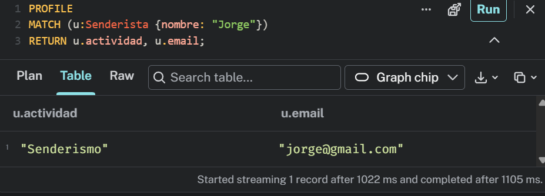

## 3.Implementar restricciones, índices y carga de datos (70 minutos)
Prepara los scripts en Cypher para asegurar la calidad y el rendimiento del grafo:

**Restricciones de unicidad (CREATE CONSTRAINT ... IS UNIQUE) para evitar IDs duplicados en nodos principales.**

Script en evidencias/indices_constraint.cypher

**Índices secundarios (CREATE INDEX) para encontrar al instante el nodo de inicio de una búsqueda sin escanear todo el grafo.**

Script en evidencias/indices_secundarios.cypher

**Carga controlada con MERGE: escribe las sentencias de inserción utilizando MERGE en lugar de CREATE, garantizando que el script sea idempotente (se pueda ejecutar varias veces seguidas sin duplicar nodos ni relaciones).**

Script en evidencias/merge.cypher

**Un dataset de prueba conectado con al menos 15 nodos y 25 relaciones para que los caminos devuelvan resultados interesantes.**

Script en evidencias/dataset_prueba.cypher

**Evidenciar el plan de ejecución de una búsqueda con PROFILE o EXPLAIN, comprobando que utiliza el índice (NodeIndexSeek).**

## 4.Resolver consultas Cypher y caminos complejos (90 minutos)

Escribe las consultas Cypher comentadas para responder a las preguntas planteadas:

**Operación básica: crear o actualizar un nodo y sus relaciones de forma segura usando MERGE y SET.**

MATCH (u:Senderista {id: 'S-002'}),
      (r:Ruta {id: 'R-2'})
MERGE (u)-[rel:CREA]->(r)
SET rel.fecha = date('2026-04-12')
RETURN u, rel, r;

**Consulta de 1 salto: buscar vecinos inmediatos (por ejemplo, todas las canciones de un artista con su duración y género).**

MATCH (u:Senderista {nombre: 'Jorge'})-[:CREA]->(r:Ruta)
RETURN r;

**Consulta de varios saltos (multi-salto): recorrer dos o más relaciones encadenadas con filtros y ordenación (por ejemplo, canciones que escuchan mis amigos pero que yo aún no he reproducido).**

MATCH (u:Montañista {id: 'M-001'})
      -[rel:REALIZA]->
      (r:Ruta {id: 'R-1'})
RETURN u, rel, r;

**Recomendación por afinidad: descubrir elementos conectados a través de patrones comunes (por ejemplo, colaboraciones compartidas entre artistas).**

**Camino más corto: calcular la distancia mínima entre dos nodos lejanos con la función shortestPath (grados de separación musical).**

**Explicar de forma sencilla por qué Neo4j resuelve estos caminos en milisegundos gracias a la adyacencia libre de índices (conexiones físicas en memoria) frente al coste de los JOIN en bases de datos relacionales.**

## 5.Comparación técnica, seguridad y copias (60 minutos)

Documenta los aspectos de arquitectura y administración:

**Comparativa técnica: elige tu consulta de recomendación o camino más interesante y explica cómo se resolvería en SQL tradicional (número de JOIN y complejidad) frente a Neo4j.**

**Copias de seguridad y restauración: procedimiento para hacer un volcado del grafo (neo4j-admin dump o exportación desde Neo4j Aura) y cómo recuperarlo.**

**Seguridad y permisos: definición de roles mínimos (usuario de consulta para la aplicación móvil frente a administrador).**

**Cuándo NO usar Neo4j: dos casos reales donde un grafo no es la herramienta adecuada y conviene usar bases de datos relacionales, documentales o columnares.**