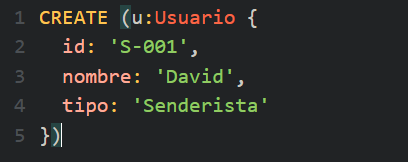
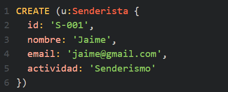
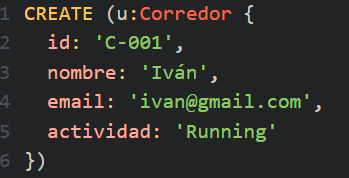
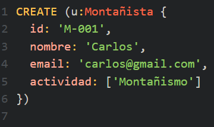
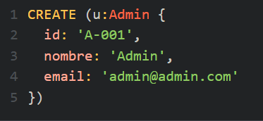
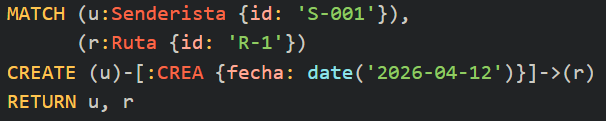
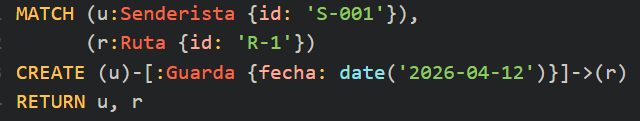
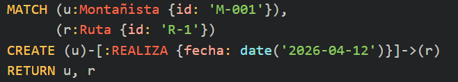
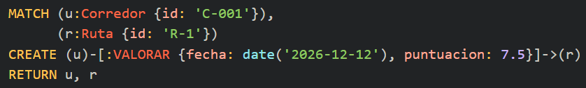
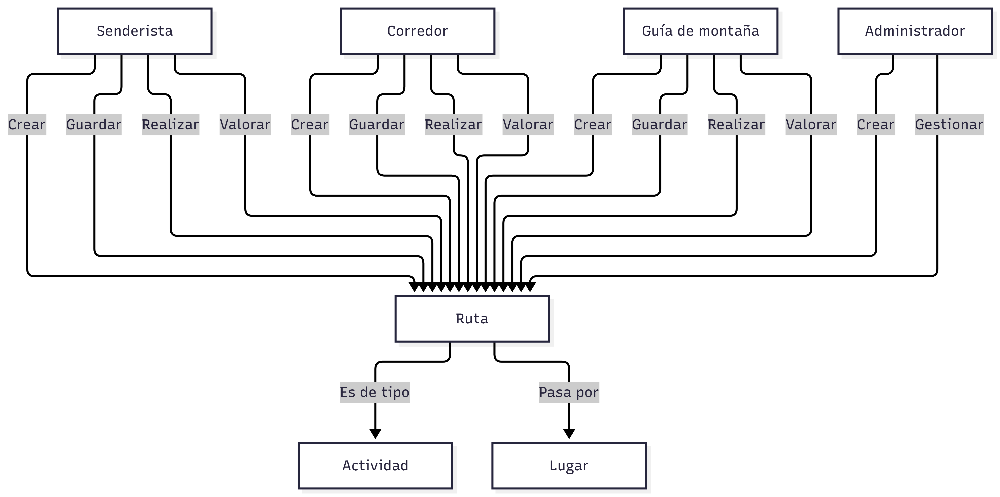

<!--En docs/modelo.md incluye el diagrama del grafo y las justificaciones de diseño-->

## 2.Diseñar el grafo de nodos y relaciones

Entrega un diagrama visual claro del modelo (utilizando Mermaid) y define la estructura de los datos:

**1- Las etiquetas de nodos (Labels, por ejemplo: :Usuario, :Cancion, :Artista) y las propiedades de cada una, indicando cuáles son obligatorias.**

:Usuario: id, nombre, email, tipo

:Senderista: id, nombre, email, actividad

:Corredor: id, nombre, email, actividad

:Montañista: id, nombre, email, actividad

:Guia: id, nombre, email, actividad

:Admin: id, nombre, email

**2- Los tipos de relación (por ejemplo: [:INTERPRETA], [:SIGUE_A], [:ESCUCHA]), su dirección y las propiedades que guardan las propias relaciones (como fechas, número de reproducciones o el orden dentro de una lista).**

[:CREA]

[:GUARDA]

[:REALIZA]

[:VALORA]

**3- La justificación de por qué cada elemento se modela como nodo o como simple propiedad (por ejemplo: por qué el Género o el Artista deben ser nodos propios y no simples textos dentro de la canción).**

| Criterio | Neo4j | MongoDB | SQL (MySQL/PostgreSQL) |
|---|---|---|---|
| Modelo de datos | Grafos: nodos y relaciones | Documentos JSON/BSON | Tablas relacionadas mediante claves |
| Relaciones entre usuarios y rutas | Se representan directamente mediante relaciones | Se gestionan mediante referencias o documentos embebidos | Se gestionan mediante claves foráneas y JOIN |
| Consultas de caminos y conexiones | Especialmente adecuado para recorrer grafos | Requiere lógica adicional para recorrer relaciones entre documentos | Puede requerir consultas recursivas o varias operaciones |
| Rutas compartidas entre usuarios | Se consultan mediante patrones de relaciones | Puede requerir varias consultas o referencias | Se consultan mediante JOIN |
| Datos flexibles | Sí | Sí, es una de sus principales características | Depende del sistema y del diseño del esquema |
| Casos de uso destacados | Redes, recomendaciones y análisis de conexiones | Datos semiestructurados y aplicaciones documentales | Datos estructurados, transacciones y consultas tabulares |

**4- La estrategia para identificadores únicos y tipos de datos compatibles con Cypher.**

La propia del id es distinta en cada nodo

**5- Los límites y riesgos del modelo: cómo evitar los supernodos (nodos con miles de relaciones directas que ralentizan las búsquedas) y qué operaciones no son recomendables en un grafo.**

<<<<<<< HEAD
En el modelo de rutas de senderismo desarrollado en Neo4j, uno de los posibles riesgos es la aparición de supernodos. Esto podría ocurrir en los nodos Actividad, si una categoría como Senderismo está conectada con miles de rutas mediante ES_DE_TIPO.

Para reducir estos riesgos, se evitará crear nodos duplicados para una misma actividad o lugar y se mantendrán únicamente las relaciones necesarias entre usuarios, rutas, actividades y lugares. Asimismo, se utilizarán identificadores estables para evitar duplicidades y la cláusula MERGE para crear nodos y relaciones cuando corresponda.

Otra limitación aparece al realizar recorridos sin límite de profundidad, ya que podrían explorarse demasiadas relaciones entre usuarios y rutas. Por ello, se utilizarán límites en las consultas cuando sean adecuados y se aplicarán filtros para recuperar únicamente la información necesaria.

=======

>>>>>>> 63a7de276c2da8bcaf4c838246c8c104b7b9c19e
